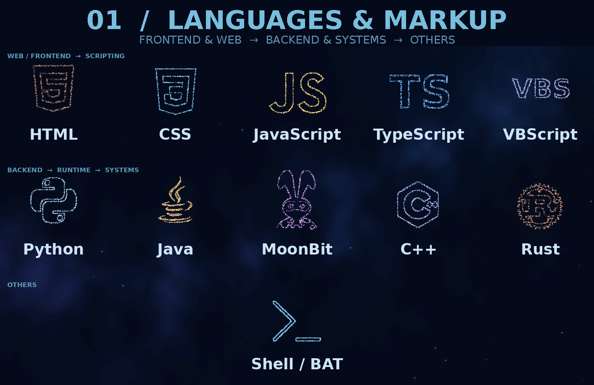
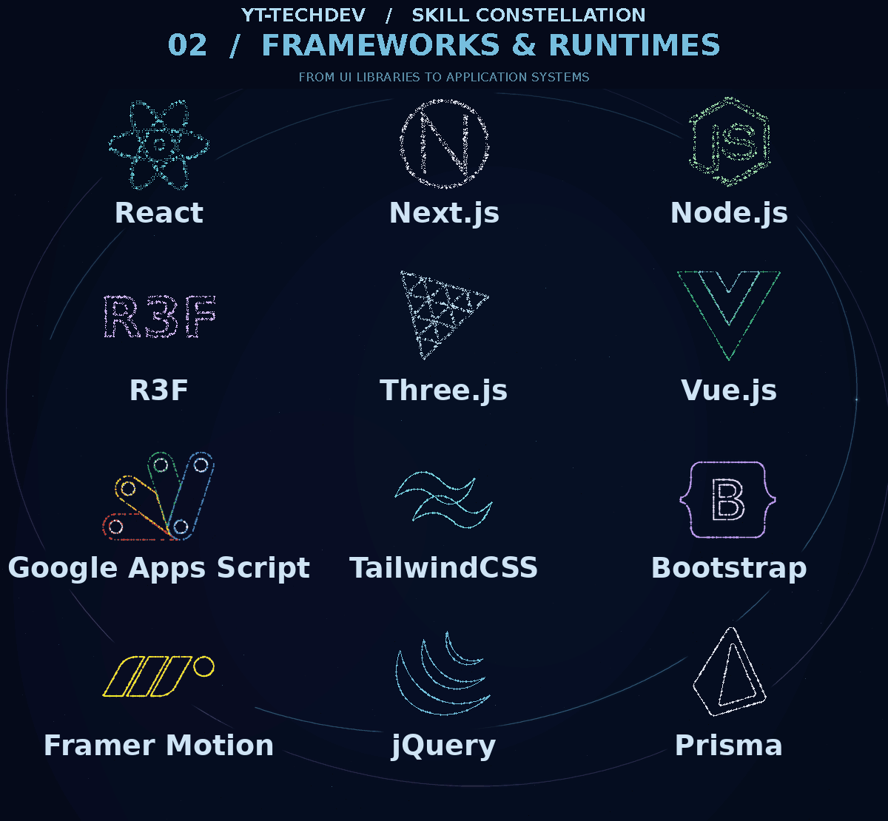
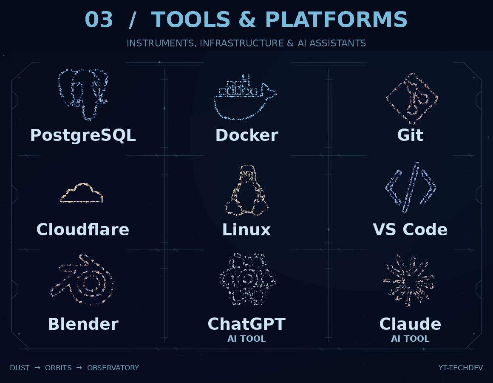

<h1 align="center">YT-TechDev</h1>

  Independent software developer building interactive systems, open-source developer tools and practical engineering workflows.

## Skill Constellation

A small constellation of languages, frameworks and tools I build with or explore. Labels such as **Exploring** describe the context, not a proficiency score.

All particle stars remain legible; activity is described with labels instead of dimming learning interests. C++ / Rust: exploring. ChatGPT / Claude: AI tools.

## Open-source engineering

| Project | Focus |
| :-- | :-- |
| **[Web Interactive Flow](https://github.com/YT-TechDev/web-interactive-flow)** | Deterministic interaction-flow runtime built with MoonBit and WebAssembly. |
| **[Frontend Analysis](https://github.com/YT-TechDev/frontend-analysis)** | Browser-independent frontend analysis and diagnostics. |
| **[R3F Interactive Flow](https://github.com/YT-TechDev/r3f-interactive-flow)** | Phase-based interaction controls for React Three Fiber experiences. |
| **[Local Virtual Kit](https://github.com/YT-TechDev/local-virtual-kit)** | Local-first virtual character tooling with native tracking and web preview. |

## Current focus

- Designing and maintaining developer tools, web runtimes and interactive experiences.
- Reproducible workflows with clear responsibility and validation boundaries.
- Documentation, architecture and long-term maintainability for open-source software.

  <a href="https://github.com/YT-TechDev?tab=repositories">Explore repositories</a>
  ·
  <a href="https://yttechdev.com">Portfolio</a>

About the constellation and icon provenance

Images are generated offline from pinned technology icon outlines. Original SVG path data comes from [my portfolio's icon renderer](https://github.com/YT-TechDev/yt-techdev-portfolio/blob/6e4ea4fdbea13d57e7eb4f0f120452a2baf63a27/components/home/Skills/particle/svgPaths.ts), with additional and repaired paths from [Simple Icons](https://github.com/simple-icons/simple-icons) and [Devicon](https://github.com/devicons/devicon). The rounded TypeScript monogram and VBScript wordmark are illustrative. Shell / BAT uses an original, vendor-neutral prompt symbol (>_) with no window frame. React Three Fiber, WebAssembly, ChatGPT and VS Code also use illustrative particle glyphs. MoonBit is traced from the official MoonBit documentation logo, not a custom moon/M symbol.

The source scripts and artwork live exclusively in this GitHub profile repository. GitHub README does not run TSX/WebGL; these are generated, non-interactive animations. See [the renderer documentation](./docs/constellation.md) for source pins, regeneration and limitations.

