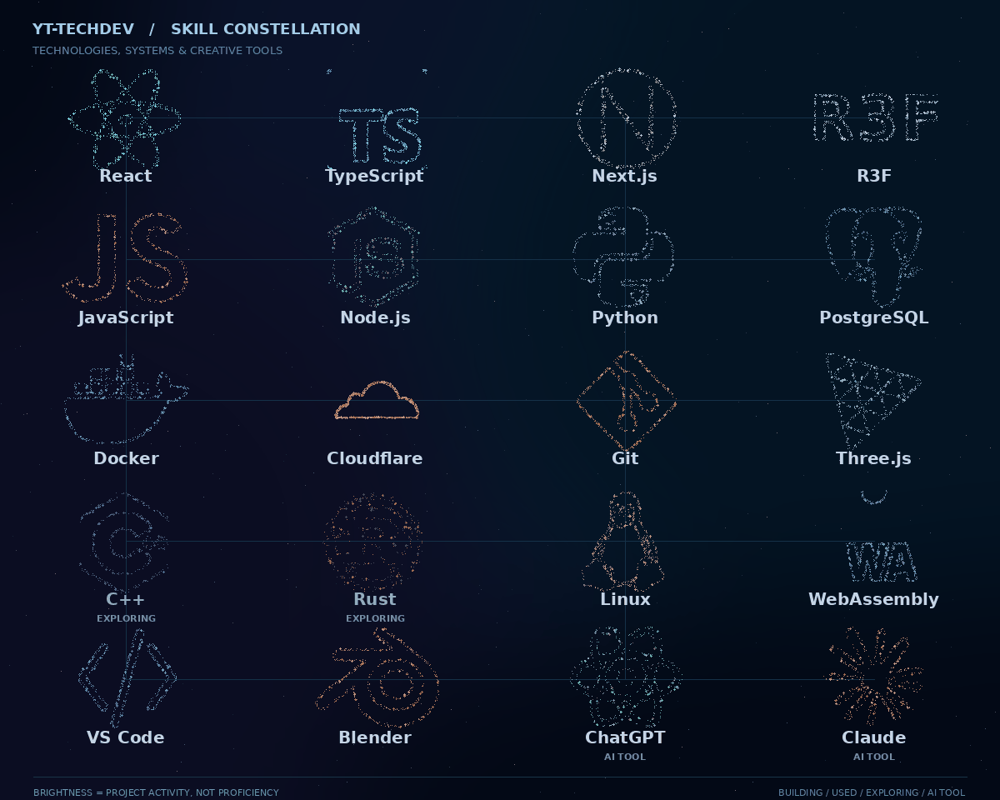

<h1 align="center">YT-TechDev</h1>

  Independent software developer building interactive systems, open-source developer tools and practical engineering workflows.

  

20 particle constellations for languages, systems and tools. Brightness reflects development activity, <strong>not</strong> skill ratings. Rust and C++ are exploring; ChatGPT and Claude are AI tools.

## Open-source engineering

| Project | Focus |
| :-- | :-- |
| **[Web Interactive Flow](https://github.com/YT-TechDev/web-interactive-flow)** | A deterministic interaction-flow runtime built with MoonBit and WebAssembly. |
| **[Frontend Analysis](https://github.com/YT-TechDev/frontend-analysis)** | Browser-independent frontend analysis and diagnostics. |
| **[R3F Interactive Flow](https://github.com/YT-TechDev/r3f-interactive-flow)** | Phase-based interaction controls for React Three Fiber experiences. |
| **[Local Virtual Kit](https://github.com/YT-TechDev/local-virtual-kit)** | Local-first virtual character tooling with native tracking and a web preview. |

## What I'm working on

- Developer tooling, frontend architecture and interactive graphics.
- Reproducible workflows with clear boundaries and evidence-based validation.
- Open-source components designed to be understandable and maintainable.

  <a href="https://github.com/YT-TechDev?tab=repositories">Explore repositories</a>
  ·
  <a href="https://yttechdev.com">Portfolio</a>

About the constellation

The artwork is generated from technology-logo outlines taken from a pinned revision of my [portfolio's particle icon assets](https://github.com/YT-TechDev/yt-techdev-portfolio/blob/6e4ea4fdbea13d57e7eb4f0f120452a2baf63a27/components/home/Skills/particle/svgPaths.ts), and repaired or supplemental 24×24 icon paths from [Simple Icons](https://github.com/simple-icons/simple-icons).

The source data and renderer live in this profile repository. The illustrative VS Code and ChatGPT motifs are not official brand logos. Regeneration is repeatable and does not require React in the README. GitHub README pages cannot execute arbitrary React/TSX or WebGL. The README displays the generated GIF; a lightweight static SVG and PNG are also retained.

Labels refer to public projects, usage and areas of exploration. They do not assert levels of competence or measure GitHub activity automatically.

